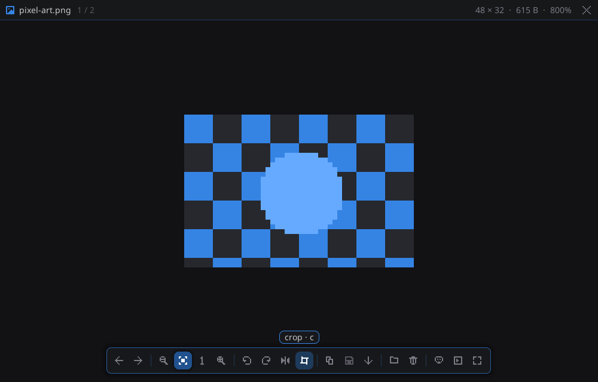
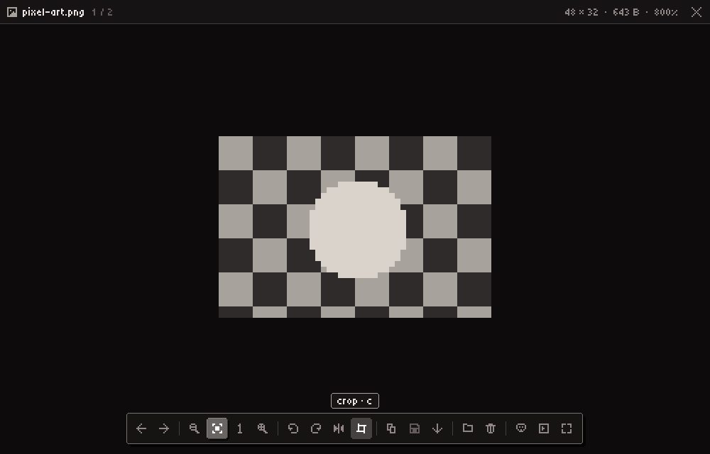

# yami-view

English · [Русский](README.ru.md)

An image viewer and quick editor for Wayland: opens at once, leafs through the folder, shows honest
pixels when zoomed, rotates, flips, crops and saves. Its own renderer, no toolkit. Part of the
[yami](https://github.com/Trendorin/yami) desktop, and works on its own on any Wayland compositor:
no yami shell needed.

| neutral look (`plain`) | pixel look (`yami`) |
|---|---|
|  |  |

## What it does

- PNG, JPEG, GIF and WebP (animated too), BMP, ICO, TGA, PNM; the neighbours decode ahead.
- Fit, actual size, zoom to the cursor with sharp pixels, pan; the theme's background, black or
  light, a checkerboard under transparent pictures.
- Rotate, flip, crop, undo; save over the file or as a new one (through yami-files' dialog when it
  is installed).
- A slideshow, full screen, file details, copy to the clipboard, to the trash, «set as wallpaper».

## Install

**One file** (x86_64, glibc 2.34 or newer):

```sh
curl -LO https://github.com/Trendorin/yami/releases/latest/download/yami-view
chmod +x yami-view
./yami-view install
```

No Rust and no root. `install` asks the language, the look and whether pictures should open in it
by default, lists what it will change and writes into `~/.local` only after your yes (`--yes` takes
the defaults, `--all` says yes to every question).

**From source** (Rust 1.89 or newer): `git clone https://github.com/Trendorin/yami-view`, then
`cargo build --release --locked` and `target/release/yami-view install`. The drawing library,
yami-px, comes with the build from the [yami](https://github.com/Trendorin/yami) repository.

It needs wayland and libxkbcommon (`yami-view deps`); `yami-view uninstall` takes everything back.

## Use

```sh
yami-view [FILE|FOLDER…]    # a picture and its folder, or a folder from the first picture
yami-view shot -o DIR       # the window as PNG without Wayland
```

| Keys | |
|---|---|
| ←, →, Home, End | previous, next, first, last |
| 0, 1, 2, + and - | fit, actual size, 200 %, zoom in and out |
| R, Shift+R, H, V | rotate right, left, flip horizontally, vertically |
| C, Enter | crop, apply it |
| Ctrl+S, Ctrl+Shift+S, Ctrl+Z, Ctrl+C | save, save as, undo, copy |
| Space, F, I, B | slideshow, full screen, details, background |
| W, E, Delete | set as wallpaper, open its folder, to the trash |
| Esc, Ctrl+Q | close |

«Set as wallpaper» outside the yami desktop runs the command in `wallpaperCmd` of `style.json`,
`{}` is the picture: `"wallpaperCmd": "swww img {}"`, `"swaybg -m fill -i {}"` or anything else.
The path goes as its own argument, never through a shell.

## Look and themes

Without any configuration it takes a neutral look: the system font, rounded corners, soft shadows,
light or dark as your system is set. Every part of it can be changed in two files, and the window
restyles itself the moment you save them:

| File | What |
|---|---|
| `~/.config/yami/style.json` | the look of every yami program: write a theme once, all of them take it |
| `~/.config/yami/style.view.json` | what yami-view does differently (only those keys) |

| Key | Values |
|---|---|
| `preset` | `plain` (neutral) or `yami` (pixel art: whole pixels, notched corners, the Tiny5 font inside the binary) |
| `palette`, `accent` | `blood`, `ash`, `sakura`, `amber`, `venom`, `ice`, `dusk`; or any `#rrggbb`: the rest of the palette is made from it |
| `light` | `true` or `false`; absent: as the system |
| `corners`, `radius` | `notch`, `round` or `square`; the radius in pixels |
| `shadow`, `bevel` | `hard`, `soft` or `none`; a raised edge on buttons |
| `reveal` | how panels appear: `fade`, `none`, `dither`, `scan`, `noise`, `wipe`, `blocks` |
| `font`, `fontView` | a font family for every program, or for this one |
| `animations`, `animSpeed` | on or off; their length (0.5 fast, 2 slow) |
| `colors` | any of `bg panel surface surfaceHi codeBg border dim accent deep glow bright selection text textDim textFaint onAccent textHi ok warn` |
| `lang` | `ru`, `en`, `pt-BR`; empty: as the system |
| `wallpaperCmd` | the «set as wallpaper» command, see above |

For example the pixel look in amber: `{ "preset": "yami", "palette": "amber" }`, or a neutral light
one with square corners: `{ "preset": "plain", "light": true, "corners": "square" }`. Inside the
yami desktop the shell writes `style.json` itself; `style.view.json` still wins.

## License

MIT
