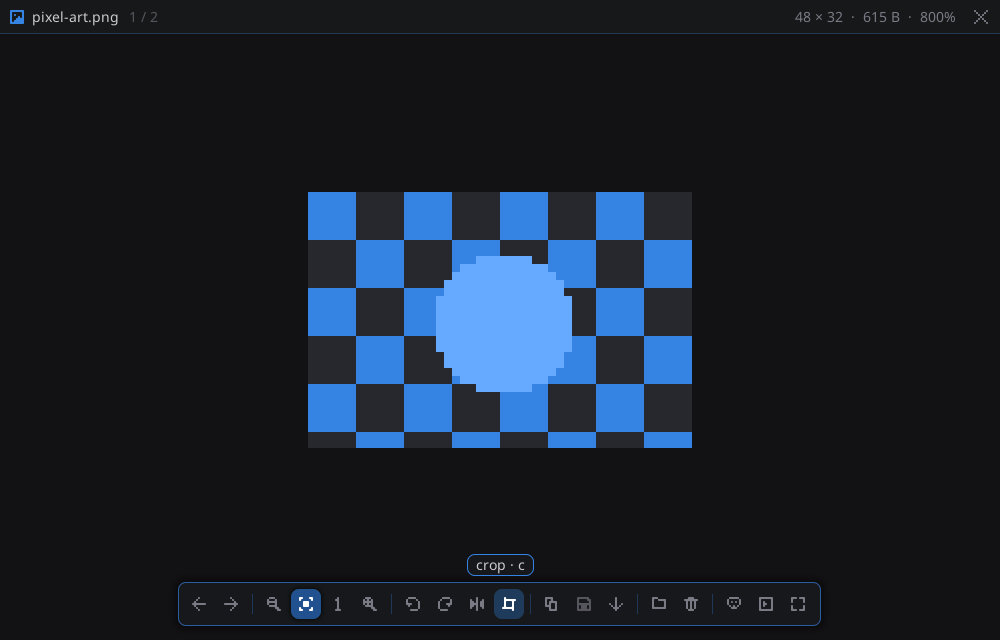
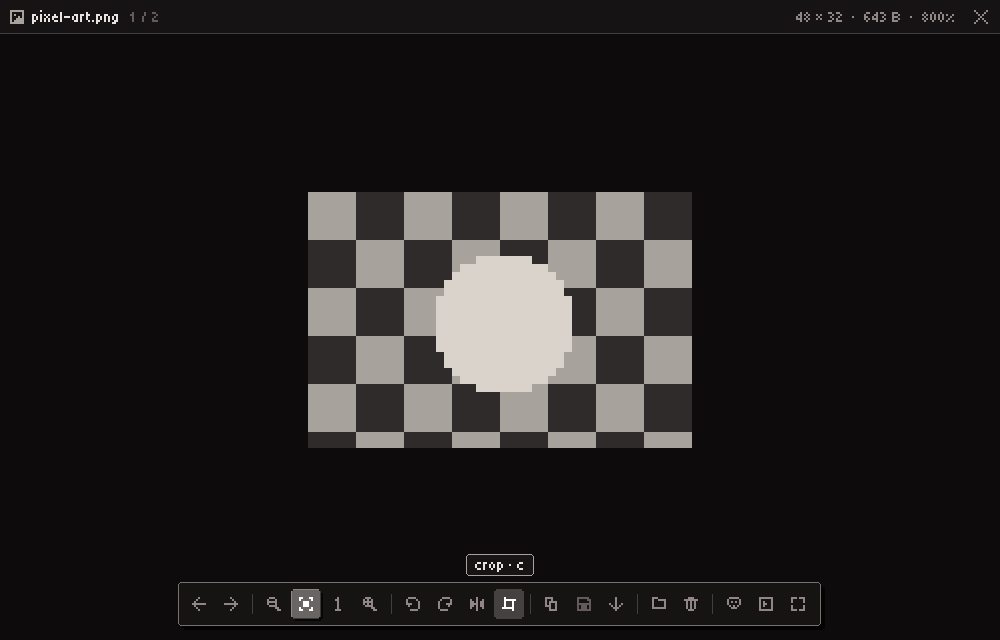

# nemo-view

[English](README.md) · Русский

Просмотрщик и быстрый редактор картинок для Wayland: открывается сразу, листает папку, при
увеличении показывает честные пиксели, поворачивает, отражает, кадрирует и сохраняет. Свой рендер,
без тулкитов. Часть рабочего стола [Nemo](https://github.com/HamzaAkramv15/nemo), которая работает и
сама по себе в любом Wayland-композиторе: шелл nemo не нужен.

| нейтральный вид (`plain`) | пиксельный вид (`nemo`) |
|---|---|
|  |  |

## Что умеет

- PNG, JPEG, GIF и WebP (и анимированные), BMP, ICO, TGA, PNM; соседние картинки декодируются наперёд.
- По размеру окна, один к одному, увеличение к курсору с чёткими пикселями, перетаскивание; фон
  темы, чёрный или светлый, шахматка под прозрачными картинками.
- Поворот, отражение, кадрирование, отмена; сохранить поверх или новым файлом (через диалог
  nemo-files, если он стоит).
- Слайд-шоу, весь экран, сведения о файле, копия в буфер обмена, в корзину, «сделать обоями».

## Установка

**Один файл** (x86_64, glibc 2.34 или новее):

```sh
curl -LO https://github.com/HamzaAkramv15/nemo/releases/latest/download/nemo-view
chmod +x nemo-view
./nemo-view install
```

Без Rust и root. `install` спросит язык, вид и открывать ли картинки в нём по умолчанию, покажет,
что изменит, и запишет в `~/.local` только после твоего «да» (`--yes` берёт ответы по умолчанию,
`--all` отвечает «да» на всё).

**Из исходников** (Rust 1.89 или новее): `git clone https://github.com/HamzaAkramv15/nemo-view`, затем
`cargo build --release --locked` и `target/release/nemo-view install`. Библиотека рисования nemo-px
приходит при сборке из репозитория [Nemo](https://github.com/HamzaAkramv15/nemo).

Нужны wayland и libxkbcommon (`nemo-view deps`); `nemo-view uninstall` убирает всё обратно.

## Как пользоваться

```sh
nemo-view [ФАЙЛ|ПАПКА…]     # картинка и её папка, или папка с первой картинки
nemo-view shot -o ПАПКА     # окно в PNG без Wayland
```

| Клавиши | |
|---|---|
| ←, →, Home, End | предыдущая, следующая, первая, последняя |
| 0, 1, 2, + и - | по размеру окна, один к одному, 200 %, крупнее и мельче |
| R, Shift+R, H, V | повернуть вправо, влево, отразить по горизонтали, по вертикали |
| C, Enter | кадрировать, применить |
| Ctrl+S, Ctrl+Shift+S, Ctrl+Z, Ctrl+C | сохранить, сохранить как, отменить, копировать |
| Space, F, I, B | слайд-шоу, весь экран, сведения, фон |
| W, E, Delete | сделать обоями, открыть папку, в корзину |
| Esc, Ctrl+Q | закрыть |

«Сделать обоями» вне рабочего стола nemo запускает команду из `wallpaperCmd` в `style.json`, `{}` —
это картинка: `"wallpaperCmd": "swww img {}"`, `"swaybg -m fill -i {}"` или что угодно другое. Путь
уходит отдельным аргументом, никогда через оболочку.

## Вид и темы

Без настроек программа выглядит нейтрально: системный шрифт, скруглённые углы, мягкие тени,
светлая или тёмная тема как в системе. Любую часть меняют два файла, и окно перекрашивается в тот
же миг, как ты их сохранишь:

| Файл | Что |
|---|---|
| `~/.config/nemo/style.json` | вид всех программ nemo: тема пишется один раз, все её берут |
| `~/.config/nemo/style.view.json` | чем nemo-view отличается (только эти ключи) |

| Ключ | Значения |
|---|---|
| `preset` | `plain` (нейтральный) или `nemo` (пиксель-арт: целые пиксели, углы с вырезом, шрифт Tiny5 внутри бинаря) |
| `palette`, `accent` | `blood`, `ash`, `sakura`, `amber`, `venom`, `ice`, `dusk`; или любой `#rrggbb`: остальная палитра строится от него |
| `light` | `true` или `false`; нет ключа — как в системе |
| `corners`, `radius` | `notch`, `round` или `square`; радиус в пикселях |
| `shadow`, `bevel` | `hard`, `soft` или `none`; выпуклый край у кнопок |
| `reveal` | как появляются панели: `fade`, `none`, `dither`, `scan`, `noise`, `wipe`, `blocks` |
| `font`, `fontView` | семейство шрифта для всех программ или только для этой |
| `animations`, `animSpeed` | вкл/выкл; их длительность (0.5 быстро, 2 медленно) |
| `colors` | любой из `bg panel surface surfaceHi codeBg border dim accent deep glow bright selection text textDim textFaint onAccent textHi ok warn` |
| `lang` | `ru`, `en`, `pt-BR`, `es`, `de`, `fr`, `uk`, `pl`; пусто — как в системе |
| `wallpaperCmd` | команда «сделать обоями», см. выше |

Например, пиксельный вид в янтаре: `{ "preset": "nemo", "palette": "amber" }`, или нейтральный
светлый с прямыми углами: `{ "preset": "plain", "light": true, "corners": "square" }`. В рабочем
столе nemo `style.json` пишет сам шелл; `style.view.json` всё равно главнее.

## Лицензия

MIT
